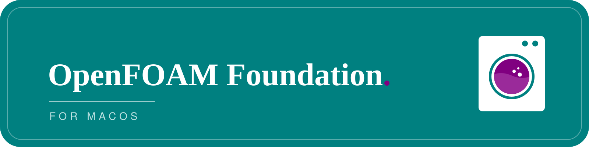

<picture>
  <source media="(prefers-color-scheme: dark)" srcset="assets/banner-dark.svg">
  
</picture>

# OpenFOAM 14 for macOS

Run OpenFOAM Foundation 14 natively on Apple Silicon. Install it with Homebrew and start working on your cases from Terminal.

## Install

You need an Apple Silicon Mac and [Homebrew](https://brew.sh/). See [Releases](https://github.com/PentagonToy/OpenFOAM-MacOS/releases) for supported macOS versions.

```sh
brew install --cask pentagontoy/tap/openfoam-14
```

Open MPI is included for parallel runs.

## Start OpenFOAM

Open **OpenFOAM-14** in Applications, or enter the same environment from your current directory.

```sh
openfoam-14
```

To run a command directly from your shell or a script, pass it to the launcher.

```sh
openfoam-14 -- foamRun -help
```

Use `openfoam-14 --help` to see launcher options and `openfoam-14 --version` to identify the installed package. Both commands work before the volume is mounted.

Either launch mounts the read-only `OpenFOAM-14` volume automatically. Keep simulation cases in your usual working directory. When your sessions have ended, eject the volume with `openfoam-14 --eject`.

## Project references

| Project | What we use |
| --- | --- |
| [OpenFOAM Foundation](https://github.com/OpenFOAM/OpenFOAM-14) | The OpenFOAM 14 solver, tools and tutorials. |
| [openfoam-macos](https://github.com/rathse/openfoam-macos) | The starting point for our macOS patches, which we maintain in this repository. |
| [openfoam-app](https://github.com/gerlero/openfoam-app) | The Finder and Homebrew launch experience, and macOS regression reports. |

## Build and licence

See [Build an add-on](docs/extensions.md) for user solvers and libraries, the [build guide](docs/build.md) for offline rebuilds, and the [macOS compatibility notes](docs/compatibility.md) for the issues behind our tests. The packaging source is distributed under the [GNU General Public License, version 3](LICENSE).
